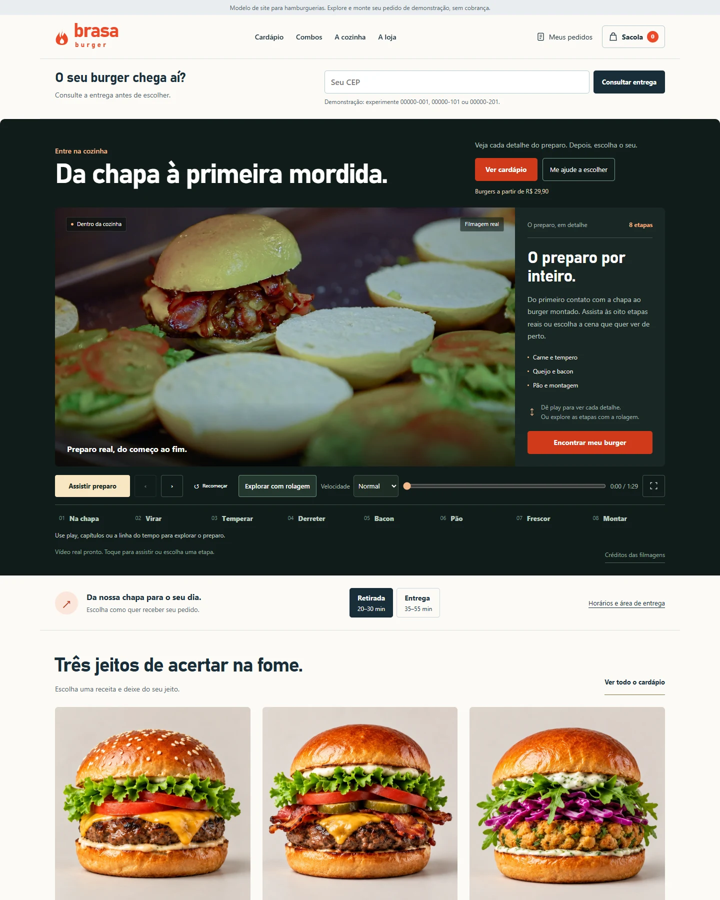

# Brasa Burger

Modelo de loja virtual para hamburguerias, com cardápio visual, filme de preparo, personalização do pedido e uma experiência de compra pensada para o celular.

[**Ver demonstração**](https://passosnikolas5-coder.github.io/brasa-burger-template/) · [**Código do projeto**](https://github.com/passosnikolas5-coder/brasa-burger-template)



## Uma vitrine para apresentar aos clientes

A abertura mostra filmagens reais do preparo, com capítulos e controles de reprodução. O cardápio reúne 14 produtos entre burgers, combos, porções, bebidas e sobremesas, com imagens consistentes e ingredientes descritos. O cliente pode escolher rapidamente entre “O clássico”, “Para muita fome” e “Vegetariano”, ou explorar o catálogo completo.

Esta publicação é um **modelo demonstrativo**. A marca, os preços, os horários e as áreas de entrega são exemplos. As fotos do catálogo foram geradas por IA; as filmagens são de banco de vídeos e não representam uma cozinha própria da Brasa Burger. Não há avaliações fictícias, compras reais nem cobranças na demonstração.

## O que você pode experimentar

- Cardápio com busca, categorias, ordenação, favoritos e alternância entre fotos e lista.
- Ajuda para escolher um burger por tipo, ingrediente e orçamento.
- Personalização com adicionais, retirada de ingredientes, observações e quantidade.
- Transformação de burgers em combo, com porção, bebida, total e economia apresentados antes da adição.
- Sacola com edição de itens, sugestões de complementos, cupom e opção de desfazer a última remoção.
- Consulta demonstrativa de entrega por CEP, com região, taxa, prazo e pedido mínimo.
- Resumo do pedido para conferir e copiar, sem pagamento ou envio automático à cozinha.
- Layout responsivo, navegação por teclado, preferências de movimento reduzido e imagens WebP em tamanhos adequados à tela.

Para testar a entrega, use **00000-001**, **00000-101** ou **00000-201**. São CEPs fictícios: a demonstração não consulta endereços reais.

## Demonstração pública e versão com servidor

O GitHub Pages hospeda a interface estática. O projeto também inclui um servidor Python para demonstrar a operação local.

| Recurso | GitHub Pages | Servidor local |
| --- | --- | --- |
| Filme, cardápio, personalização e sacola | Disponível | Disponível |
| Consulta de CEP | Simulação com as faixas de exemplo | Consulta e revalidação das faixas configuradas |
| Finalização | Gera um resumo offline | Registra pedido de demonstração em SQLite |
| Acompanhamento | Sem registro de pedido no servidor | Consulta mudanças feitas pelo painel a cada 15 segundos com o recibo ou histórico aberto |
| Avaliações | Área demonstrativa, sem comentários inventados | Pedidos concluídos podem avaliar; publicação depende de moderação |
| Fidelidade | Benefício apresentado como exemplo | Cinco compras concluídas geram R$ 12,90 para pedido futuro, conforme as regras da demonstração |
| Operação da loja | Sem painel conectado | Pausa de pedidos, produtos esgotados, prazo adicional, mídias próprias e contagens agregadas |
| Pix e cartão online | Desativados | Adaptador opcional preparado, também desativado na demonstração |

O status do pedido **não avança por um temporizador**: na versão local, ele acompanha as alterações da operação. As contagens do painel representam eventos agregados; não são visitantes únicos nem uma taxa de conversão individual.

## Executar a versão local

Requer **Python 3.10 ou superior**. O backend usa a biblioteca padrão, sem instalar pacotes adicionais. A partir da raiz do repositório:

```powershell
python server.py --port 4187 --state-dir ../brasa-burger-private
```

- Loja: `http://127.0.0.1:4187/brasa-burger/index.html`
- Painel: `http://127.0.0.1:4187/brasa-burger/admin.html`

O terminal informa onde foi criado o arquivo privado `admin-key.txt`, usado para entrar no painel. Os pedidos e a chave ficam na pasta escolhida em `--state-dir`, fora do site e do repositório. Os arquivos `server.py`, `operations.py` e `payments.py` devem permanecer juntos.

O servidor incluído é uma demonstração local. Uma operação real exige hospedagem apropriada, HTTPS, credenciais privadas, backups, dados de atendimento e integração com a cozinha. As orientações de pagamento estão em [PAGAMENTOS.md](PAGAMENTOS.md); a configuração não equivale à homologação de uma conta real do provedor.

## Personalizar para outra hamburgueria

1. Edite `store-data.js`: produtos, receitas, preços em centavos, adicionais, cupom, endereço, horários e regiões de entrega. Preserve o formato `window.BRASA_DATA = { ... };` com JSON estrito.
2. Ajuste os textos e a identidade em `index.html` e nos arquivos CSS. Revise as informações de ingredientes e alérgenos de acordo com os produtos realmente vendidos.
3. Substitua as imagens por fotos da hamburgueria e grave seu processo de preparo. A versão local permite enviar foto por produto e vídeo da cozinha pelo painel.
4. Atualize contatos, condições de venda e privacidade. O WhatsApp está vazio; só habilite o compartilhamento após inserir um número real. O envio da mensagem continua dependendo da ação do cliente.
5. Gere a versão estática com `python scripts/build-pages.py --out public` e confira a interface antes de atualizar o repositório. O workflow repete essa preparação; `public/` é uma saída gerada, ignorada pelo Git.

Consulte [GITHUB-PAGES.md](GITHUB-PAGES.md) para a organização da publicação e [ETAPAS.md](ETAPAS.md) para as nove melhorias da loja.

## Qualidade e validação

A revisão do modelo foi validada em Edge automatizado, com telas simuladas de **1440, 768, 390 e 320 pixels**, além de testes isolados do backend, da experiência e do adaptador de pagamento com respostas simuladas. Aparelhos físicos e outros motores de navegador não foram testados. Testes com mocks não representam pagamentos reais ou homologação do provedor.

As 14 imagens do catálogo têm fontes de **1254 × 1254 pixels** e versões WebP de 640 e 1254 pixels. O filme tem versões Full HD e 720p. Exportações ampliadas em 8K, documentadas no projeto original, são interpoladas e não representam captura ou geração nativa em 8K; não são necessárias para esta demonstração.

## Créditos e uso dos materiais

- **Fotos do catálogo:** geradas por IA para representar as receitas demonstrativas. Prompts e histórico em [PROMPTS.md](PROMPTS.md).
- **Filmagem principal:** [Pilan Filmes — Hands preparing hamburger](https://www.pexels.com/video/hands-preparing-hamburger-12282853/).
- **Filmagem complementar:** [Katerina Holmes — Person cooking patties on a frying pan](https://www.pexels.com/video/person-cooking-patties-on-a-frying-pan-5906561/).
- **Origem e condições das filmagens:** [SOURCES-video.md](SOURCES-video.md), [licença Pexels](https://www.pexels.com/license/) e [termos do Pexels](https://www.pexels.com/terms-of-service/).
- **Referências funcionais:** [REFERENCIAS.md](REFERENCIAS.md). Não foram reutilizados código, identidade ou imagens das marcas de referência.

As filmagens pertencem aos respectivos autores e seguem as condições do Pexels. Esta publicação não concede uma licença própria sobre elas nem sugere endosso dos autores ao estabelecimento. O repositório público permite visualizar o modelo; não foi acrescentada uma licença ampla de reutilização do código ou dos demais materiais.
